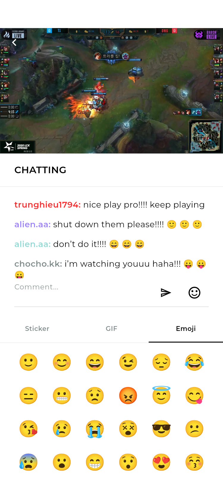
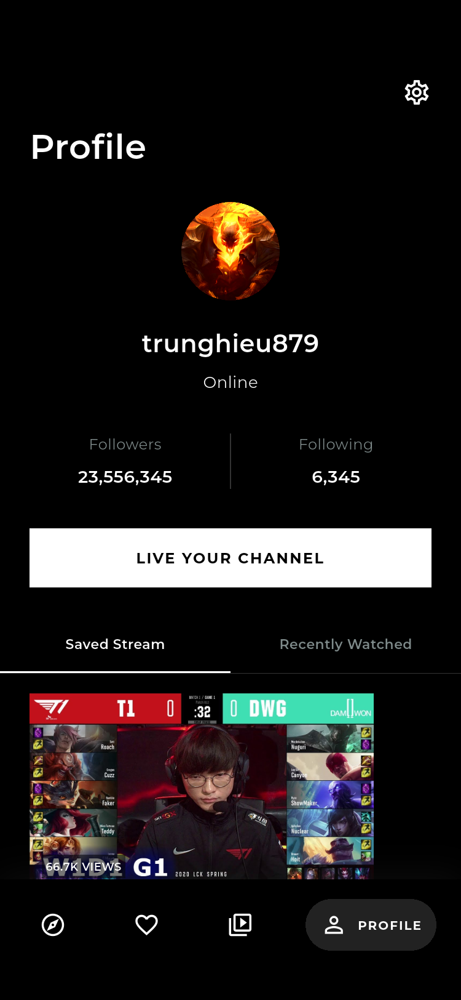

# Utubee · Flutter 直播应用

依据 Pixso 浅色与深色设计开发，包含 45 个页面与交互状态，覆盖引导、账号、发现、分类、搜索、直播聊天、频道和个人中心。

| 发现 | 直播聊天 | 深色模式 |
| --- | --- | --- |
|  |  |  |

- [项目结构与架构说明](docs/项目结构与架构说明.md)：目录、数据流、功能、运行与扩展位置。
- [全部界面截图](docs/界面截图索引.md)：45 个状态、90 张实际运行截图及原稿节点对应表。
- [Pixso 原稿截图](docs/design-reference)：浅色、深色原始设计，供开发对照。
- [Android 安装包](deliverables/Utubee-1.0.0-android-arm64.apk)：arm64 架构，Release 构建，供本地演示安装。
- [验收记录](docs/验收记录.md)：测试、模拟器和安装包验证结果。

## 运行

```bash
flutter pub get
flutter run -d emulator-5554
```

验证环境：Flutter 3.41.6 / Dart 3.11.4 / Android 15 模拟器。也可使用 `flutter run -d chrome` 运行 Web；项目同时保留 iOS 宿主源码。

登录页已填入本地演示账号。用户名至少 3 个字符，密码至少 8 个字符；注册时请更换默认用户名以避开“用户名已占用”演示。找回密码的演示验证码为 **2546**。

## 验证与构建

```bash
flutter analyze
flutter test
scripts/capture_screenshots.sh emulator-5554
flutter build apk --release
```

收藏、关注、游戏偏好、个人资料、观看历史和主题会保存在本地。图片与字体均随应用打包。

当前交付是可交互的 UI 演示：视频使用原稿静态画面，账号、聊天和密码找回使用本地逻辑；真实直播播放与推流、短信、OAuth、服务器同步和推送需接入后端服务。未存储用户密码。
