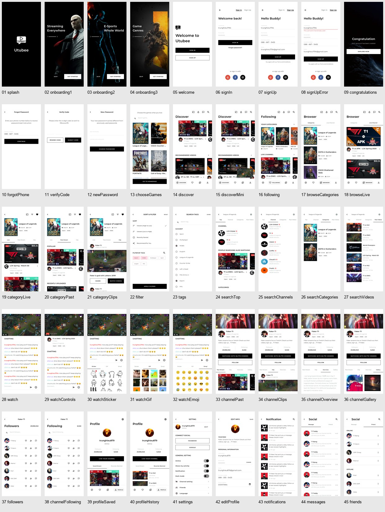
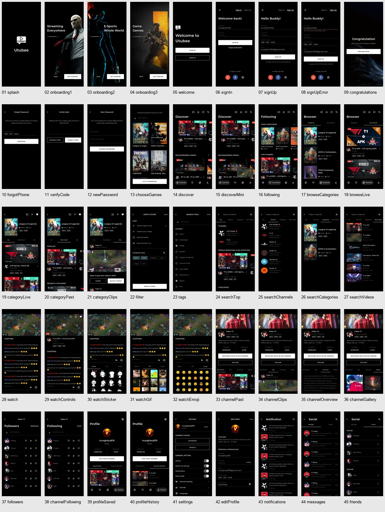

# 界面截图索引

共 45 个页面 / 状态，每个提供浅色与深色实际运行截图。长页面截图展示模拟器首屏，完整滚动内容可在应用内查看。

截图由 `integration_test/screens_test.dart` 在 Android 15 模拟器中逐页生成；原稿导出图保存在 `design-reference/light/` 和 `design-reference/dark/`，两者独立保存。

| # | Pixso 页面 / 状态 | 路由 | 浅色截图 | 深色截图 | 原稿节点 |
| --- | --- | --- | --- | --- | --- |
| 1 | Splash | `splash` | [查看](screenshots/light/splash.png) | [查看](screenshots/dark/splash.png) | `1:94` |
| 2 | Onboarding - 1 | `onboarding1` | [查看](screenshots/light/onboarding1.png) | [查看](screenshots/dark/onboarding1.png) | `1:11` |
| 3 | Onboarding - 2 | `onboarding2` | [查看](screenshots/light/onboarding2.png) | [查看](screenshots/dark/onboarding2.png) | `44:1443` |
| 4 | Onboarding - 3 | `onboarding3` | [查看](screenshots/light/onboarding3.png) | [查看](screenshots/dark/onboarding3.png) | `50:1435` |
| 5 | Welcome | `welcome` | [查看](screenshots/light/welcome.png) | [查看](screenshots/dark/welcome.png) | `50:1564` |
| 6 | Sign In | `signIn` | [查看](screenshots/light/signIn.png) | [查看](screenshots/dark/signIn.png) | `37:136` |
| 7 | Sign Up | `signUp` | [查看](screenshots/light/signUp.png) | [查看](screenshots/dark/signUp.png) | `51:279` |
| 8 | Sign Up - Wrong Input | `signUpError` | [查看](screenshots/light/signUpError.png) | [查看](screenshots/dark/signUpError.png) | `51:350` |
| 9 | Sign Up - Congratulation | `congratulations` | [查看](screenshots/light/congratulations.png) | [查看](screenshots/dark/congratulations.png) | `51:953` |
| 10 | Forgot Password - Phone Number | `forgotPhone` | [查看](screenshots/light/forgotPhone.png) | [查看](screenshots/dark/forgotPhone.png) | `51:419` |
| 11 | Forgot Password - Verify Code | `verifyCode` | [查看](screenshots/light/verifyCode.png) | [查看](screenshots/dark/verifyCode.png) | `51:547` |
| 12 | Forgot Password - New Password | `newPassword` | [查看](screenshots/light/newPassword.png) | [查看](screenshots/dark/newPassword.png) | `51:729` |
| 13 | Choose Game | `chooseGames` | [查看](screenshots/light/chooseGames.png) | [查看](screenshots/dark/chooseGames.png) | `37:848` |
| 14 | Discover | `discover` | [查看](screenshots/light/discover.png) | [查看](screenshots/dark/discover.png) | `95:0` |
| 15 | Discover - Small Screen | `discoverMini` | [查看](screenshots/light/discoverMini.png) | [查看](screenshots/dark/discoverMini.png) | `119:124` |
| 16 | Following | `following` | [查看](screenshots/light/following.png) | [查看](screenshots/dark/following.png) | `156:678` |
| 17 | Browse - Categories | `browseCategories` | [查看](screenshots/light/browseCategories.png) | [查看](screenshots/dark/browseCategories.png) | `172:453` |
| 18 | Browse - Live Channel | `browseLive` | [查看](screenshots/light/browseLive.png) | [查看](screenshots/dark/browseLive.png) | `174:1304` |
| 19 | Categories - Live | `categoryLive` | [查看](screenshots/light/categoryLive.png) | [查看](screenshots/dark/categoryLive.png) | `156:1029` |
| 20 | Categories - Past Stream | `categoryPast` | [查看](screenshots/light/categoryPast.png) | [查看](screenshots/dark/categoryPast.png) | `156:1323` |
| 21 | Categories - Clip | `categoryClips` | [查看](screenshots/light/categoryClips.png) | [查看](screenshots/dark/categoryClips.png) | `156:1512` |
| 22 | Sort & Filter | `filter` | [查看](screenshots/light/filter.png) | [查看](screenshots/dark/filter.png) | `156:1713` |
| 23 | Sort & Filter - Search Tags | `tags` | [查看](screenshots/light/tags.png) | [查看](screenshots/dark/tags.png) | `160:90` |
| 24 | Search Result - Top | `searchTop` | [查看](screenshots/light/searchTop.png) | [查看](screenshots/dark/searchTop.png) | `174:2689` |
| 25 | Search Result - Channel | `searchChannels` | [查看](screenshots/light/searchChannels.png) | [查看](screenshots/dark/searchChannels.png) | `174:3121` |
| 26 | Search Result - Categories | `searchCategories` | [查看](screenshots/light/searchCategories.png) | [查看](screenshots/dark/searchCategories.png) | `174:3331` |
| 27 | Search Result - Past Videos | `searchVideos` | [查看](screenshots/light/searchVideos.png) | [查看](screenshots/dark/searchVideos.png) | `174:3469` |
| 28 | Live Watching | `watch` | [查看](screenshots/light/watch.png) | [查看](screenshots/dark/watch.png) | `95:179` |
| 29 | Live Watching - Tapping | `watchControls` | [查看](screenshots/light/watchControls.png) | [查看](screenshots/dark/watchControls.png) | `109:21` |
| 30 | Live Watching - Chat Sticker | `watchSticker` | [查看](screenshots/light/watchSticker.png) | [查看](screenshots/dark/watchSticker.png) | `111:0` |
| 31 | Live Watching - Chat GIF | `watchGif` | [查看](screenshots/light/watchGif.png) | [查看](screenshots/dark/watchGif.png) | `114:42` |
| 32 | Live Watching - Chat Emoji | `watchEmoji` | [查看](screenshots/light/watchEmoji.png) | [查看](screenshots/dark/watchEmoji.png) | `114:117` |
| 33 | Info Channel - Past Stream | `channelPast` | [查看](screenshots/light/channelPast.png) | [查看](screenshots/dark/channelPast.png) | `116:4161` |
| 34 | Info Channel - Clip | `channelClips` | [查看](screenshots/light/channelClips.png) | [查看](screenshots/dark/channelClips.png) | `116:5009` |
| 35 | Info Channel - Overview | `channelOverview` | [查看](screenshots/light/channelOverview.png) | [查看](screenshots/dark/channelOverview.png) | `116:5187` |
| 36 | Info Channel - Gallery | `channelGallery` | [查看](screenshots/light/channelGallery.png) | [查看](screenshots/dark/channelGallery.png) | `116:5265` |
| 37 | Info Channel - Followers | `followers` | [查看](screenshots/light/followers.png) | [查看](screenshots/dark/followers.png) | `116:5325` |
| 38 | Info Channel - Following | `channelFollowing` | [查看](screenshots/light/channelFollowing.png) | [查看](screenshots/dark/channelFollowing.png) | `116:5668` |
| 39 | Profile - Saved Stream | `profileSaved` | [查看](screenshots/light/profileSaved.png) | [查看](screenshots/dark/profileSaved.png) | `147:0` |
| 40 | Profile - Recently Watched | `profileHistory` | [查看](screenshots/light/profileHistory.png) | [查看](screenshots/dark/profileHistory.png) | `147:294` |
| 41 | Profile - Setting | `settings` | [查看](screenshots/light/settings.png) | [查看](screenshots/dark/settings.png) | `147:482` |
| 42 | Profile - Edit Info | `editProfile` | [查看](screenshots/light/editProfile.png) | [查看](screenshots/dark/editProfile.png) | `150:132` |
| 43 | Notification | `notifications` | [查看](screenshots/light/notifications.png) | [查看](screenshots/dark/notifications.png) | `174:1618` |
| 44 | Social - Message | `messages` | [查看](screenshots/light/messages.png) | [查看](screenshots/dark/messages.png) | `174:1879` |
| 45 | Social - Friend | `friends` | [查看](screenshots/light/friends.png) | [查看](screenshots/dark/friends.png) | `174:2112` |

## 全页面预览





## 重新生成

```bash
scripts/capture_screenshots.sh emulator-5554
```

默认将截图从 Android 应用缓存导出到 `docs/screenshots/`，测试报告不会持有全部 PNG。
