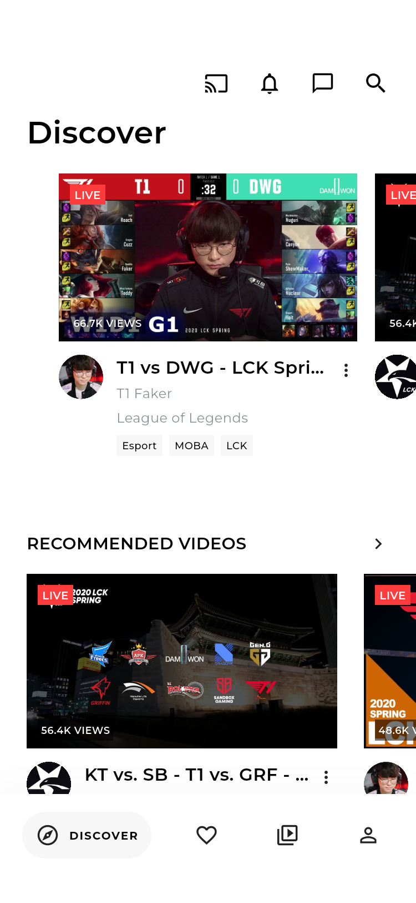
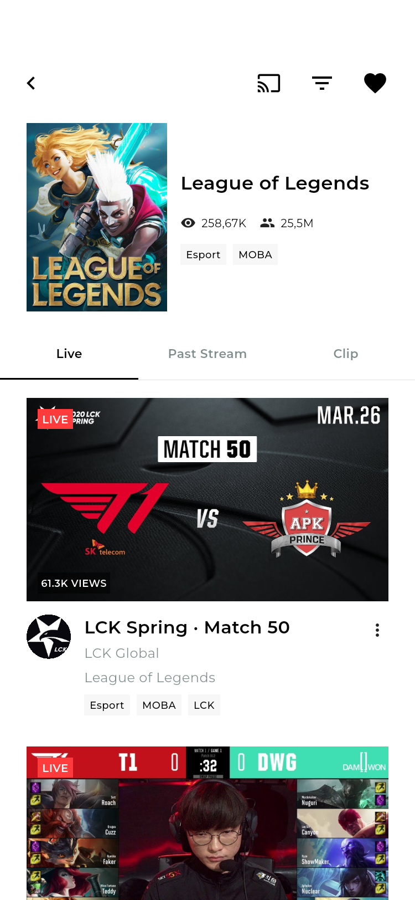
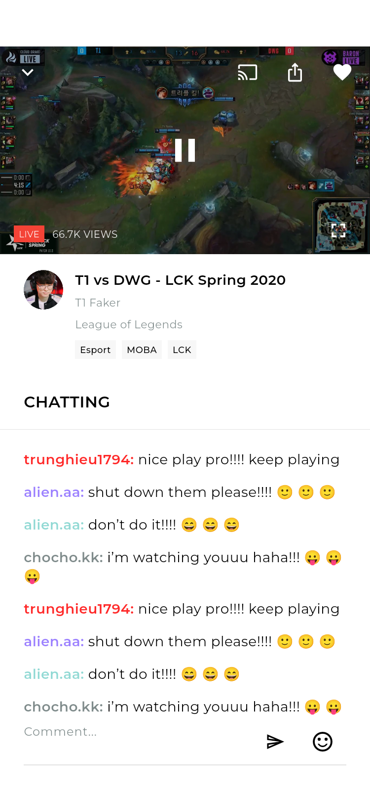
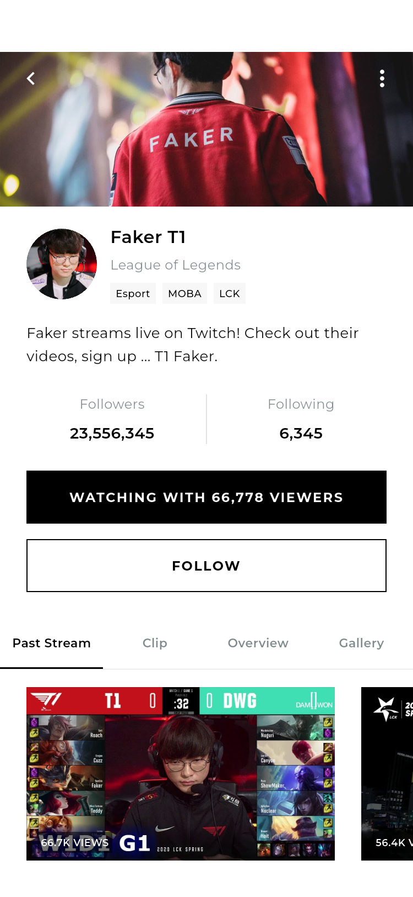
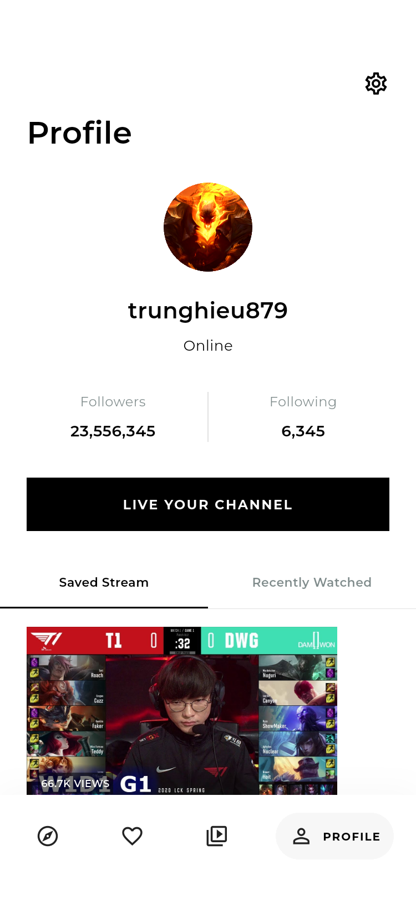
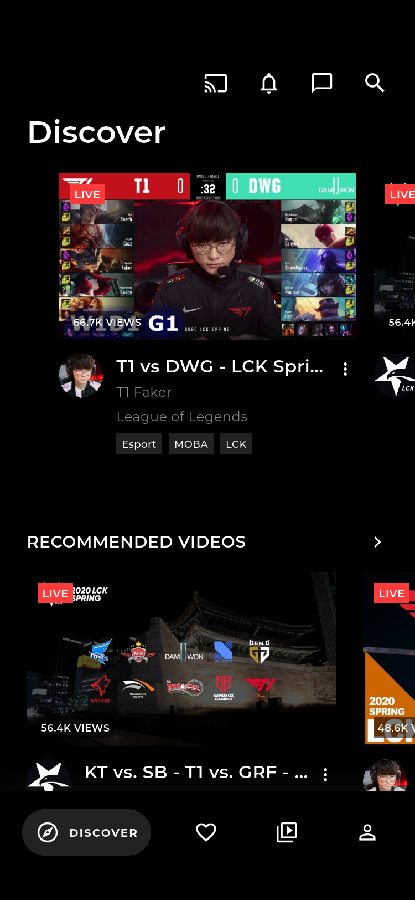
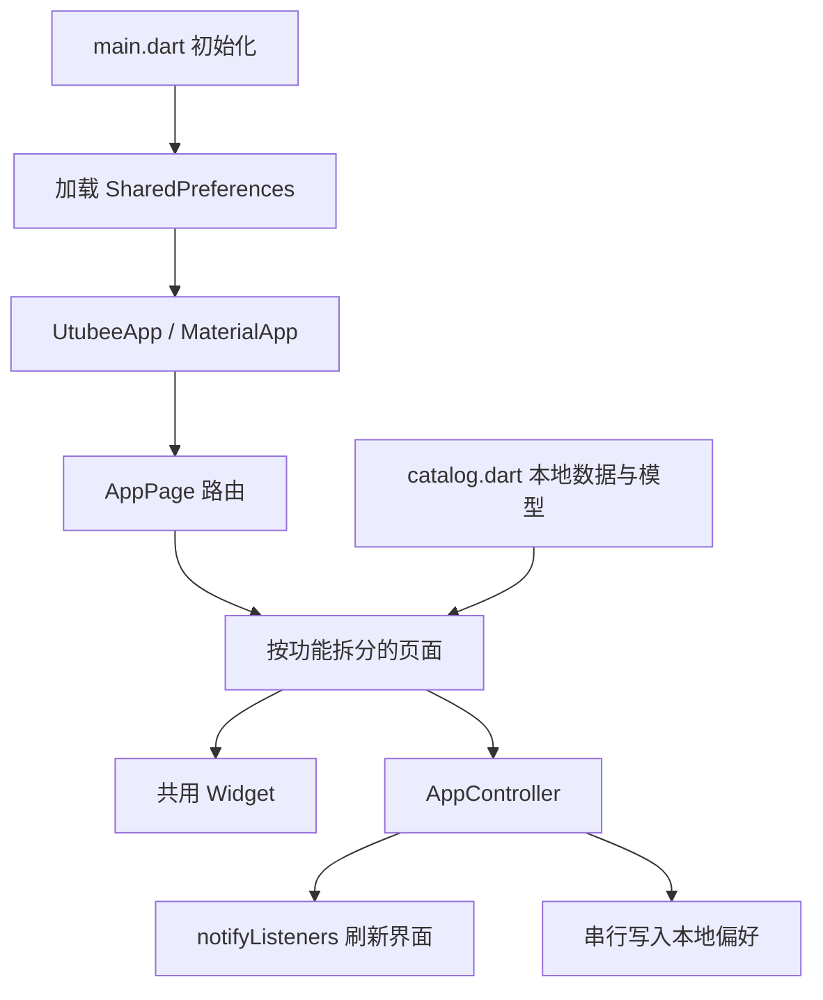

# Utubee 直播应用 · Flutter 项目说明

基于 Pixso 的 **UI Color - Light Mode / UI Color - Dark Mode** 设计开发。应用覆盖 45 个页面与交互状态，共用一套浅色、深色主题；设计中的组件总览 `Frame 1` 属于素材说明，不作为应用页面。

这是可运行、可交互的 UI 项目。直播画面使用原稿图片预览，登录、验证码、关注与收藏使用本地演示逻辑。项目没有接入直播服务、真实账号服务、短信、OAuth 或推送。

## 主要界面

以下图片来自 Android 模拟器中实际运行的 Flutter 应用。全部页面的独立截图见 [截图索引](界面截图索引.md)，原始 Pixso 导出图见 [design-reference](design-reference)。

| 发现与推荐 | 游戏分类 | 直播与聊天 |
| --- | --- | --- |
|  |  |  |

| 频道主页 | 个人中心 | 深色主题 |
| --- | --- | --- |
|  |  |  |

## 页面范围

| 模块 | 页面和状态 | 主要交互 |
| --- | --- | --- |
| 引导 | Splash、3 张 Onboarding、Welcome | 启动跳转、下一步、跳过 |
| 账号 | 登录、注册、注册错误、成功、手机号找回、验证码、新密码 | 表单校验、错误提示、演示登录与重置流程 |
| 游戏 | 选择游戏、分类直播、历史直播、剪辑 | 搜索游戏、偏好选择、分类关注、切换标签 |
| 内容 | Discover、悬浮小窗、Following、Browser 分类和直播 | 横向卡片、频道跳转、四栏导航、小窗恢复和关闭 |
| 搜索 | Top、Channel、Categories、Past Videos | 实时查询、清空、结果分类、无结果状态 |
| 筛选 | Sort & Filter、Search Tags | 观众数排序、最近开播、标签组合、重置、应用 |
| 观看 | 默认聊天、操作层、Sticker、GIF、Emoji | 收藏、复制标题、预览暂停标记、放大、小窗、发送文字与表情 |
| 频道 | Past Stream、Clip、Overview、Gallery、Followers、Following | 关注、粉丝搜索、查看图片、进入观看和消息 |
| 个人 | Saved Stream、Recently Watched、Setting、Edit Info | 收藏列表、观看历史、资料保存、日期选择、主题和开关设置 |
| 社交 | Notification、Message、Friend | 通知跳转、好友列表、会话发送演示 |

## 目录结构

```text
LiveStreaming/
├── lib/
│   ├── main.dart                     # 初始化 Flutter、加载本地状态
│   ├── app.dart                      # MaterialApp、主题、路由分发
│   ├── core/
│   │   ├── app_controller.dart        # AppController / AppScope / 本地持久化
│   │   ├── routes.dart                # 45 个路由、设计节点 ID、导航方法
│   │   └── theme.dart                 # 浅色与深色的统一主题
│   ├── data/
│   │   └── catalog.dart               # 游戏、直播模型与演示目录、素材引用
│   ├── shared/
│   │   └── widgets.dart               # 卡片、标签、按钮、页头、底部导航
│   └── features/
│       ├── auth/auth_pages.dart       # 引导、账号、找回密码、选择游戏
│       ├── browse/browse_pages.dart   # 发现、关注、浏览、分类、排序筛选
│       ├── search/search_page.dart    # 四类搜索结果
│       ├── watch/watch_page.dart      # 播放预览、聊天室、表情面板
│       ├── channel/channel_pages.dart # 频道资料、相册、关注关系
│       ├── profile/profile_pages.dart # 个人中心、设置、编辑资料
│       └── social/social_pages.dart   # 通知、消息、好友
├── assets/
│   ├── fonts/                        # Montserrat 字体与 OFL 许可
│   └── images/                       # 从 Pixso 获取的图片和表情素材
├── test/app_test.dart                 # 本地状态与关键交互、窄屏全路由测试
├── integration_test/screens_test.dart # Android 上的全页面截图遍历
├── test_driver/screens.dart           # Flutter integration_test 驱动
├── scripts/capture_screenshots.sh      # 导出全部实际运行截图
├── docs/
│   ├── 项目结构与架构说明.md           # 本文
│   ├── 界面截图索引.md                 # 所有页面 / 主题 / 原稿节点对应表
│   ├── screenshots/light/            # 实际应用浅色截图
│   ├── screenshots/dark/             # 实际应用深色截图
│   └── design-reference/             # 原稿截图，供对照
├── android/                          # Android 宿主
├── ios/                              # iOS 宿主
└── web/                              # Web 宿主
```

## 架构与数据流

采用 Flutter 原生 `ChangeNotifier + InheritedNotifier`，通过 `AppScope` 向页面提供 `AppController`。页面局部的标签索引、搜索输入和表情面板由 `StatefulWidget` 管理；跨页面共享的主题、关注、收藏、游戏偏好、个人资料及观看记录由控制器管理。



页面调用 `context.go(AppPage.channelPast)` 等导航方法。底部四个主入口使用清理旧路由的导航方式，避免重复堆积主页面；详情页使用普通入栈，返回恢复上一层。

控制器在更新后立即刷新 UI，并串行保存 JSON，避免连续操作时旧数据覆盖新状态。主题、资料、收藏、关注、游戏偏好、观看记录和通用开关会在重启后恢复；聊天、会话、搜索和筛选属于当前运行期间的演示状态。

## 设计与适配

- 使用原稿 Montserrat 字体、黑白主色、直角按钮、细分隔线、红色 LIVE 标识和真实游戏素材。
- 相同结构的浅色与深色稿由 `ThemeData` 切换，不复制两套页面代码。
- 原稿的长页面使用可滚动内容，底部导航固定；游戏、视频卡片使用横向列表。
- 手机界面以原稿 375px 为参照，支持窄屏与系统键盘；大屏将内容宽度限制为 520px。
- 输入键盘和状态栏由 Android / iOS 系统提供，因此与原稿中绘制的 iOS 键盘、状态图标有所不同。
- 图片通过本地 assets 加载，无需联网请求临时 Pixso 地址。

## 运行与演示

开发环境使用 Flutter 3.41.6、Dart 3.11.4。建议使用项目 `pubspec.lock` 中已验证的依赖版本。

```bash
flutter pub get
flutter devices
flutter run -d emulator-5554
# 或在支持的环境运行
flutter run -d chrome
```

登录页已填入演示账号。用户名至少 3 个字符，密码至少 8 个字符即可进入演示；不向服务器发送请求、不保存密码。注册时 `trunghieu1794` 为用于展示“用户名已占用”的保留值，请换一个名称完成注册。找回密码的本地演示验证码为 **2546**。

推荐体验路径：引导 → 登录 → Discover → 直播卡片 → 发送聊天 / 收藏 → 频道资料 / 关注 → Following → Profile → Setting → Dark mode。

## 验证与截图复现

```bash
flutter analyze
flutter test
scripts/capture_screenshots.sh emulator-5554
flutter build apk --release
```

5 项单元与 Widget 测试检查持久化恢复、登录校验、发送聊天、收藏、关注、个人资料修改、视频搜索的空状态，以及 360×640 逻辑尺寸下的键盘适配；同时遍历 360×800 下的全部非启动页面及两种主题。模拟器测试遍历全部 45 个页面状态、两种主题，并检查 Flutter 布局异常。

截图先逐张写入应用缓存，再通过 `adb run-as` 导出，避免将 90 张 PNG 编码为一个巨大的测试 JSON。实际截图目录为 `docs/screenshots/`，每张图片的文件名对应 `AppPage` 枚举。

## 后端扩展位置

| 接入项 | 推荐位置 |
| --- | --- |
| 账号、Token、短信与 OAuth | 为 auth 模块添加服务接口，替换表单提交；Token 使用安全存储 |
| 游戏、直播、频道列表 | 将 `catalog.dart` 演示目录替换为 repository 返回的模型 |
| 视频播放 / 直播推流 | 替换 `WatchPage` 的图片预览与控制层，接入播放器和广播 SDK |
| 直播聊天 | 将控制器的消息发送与列表接到 WebSocket / 聊天服务 |
| 资料、关注与收藏同步 | 在控制器更新方法中接入 repository，保留本地缓存 |
| 推送与设备发现 | 替换通知、投屏的演示提示，连接平台服务 |

## 代码精简

运行代码使用 14 个 Dart 文件。重复的主题、页头、底部栏、卡片、表单样式和标签组件统一复用；同一页面的标签状态复用同一实现。Pixso 自动导出的绝对定位示例已清理，保留原稿截图和设计节点记录供对照。

目前仅引入 `shared_preferences` 作为业务依赖，没有加入额外路由或状态管理框架。图片、字体均本地化；无临时设计服务 URL、计数器示例页面或未使用的 Cupertino 图标依赖。
